# Azure CycleCloud Multi-region plugin for AMLFS

`cyclecloud-multiregion-amlfs` is an **Azure CycleCloud plugin**, delivered as a native
cluster-init project, for staging Slurm workload data between regional Azure
Managed Lustre (AMLFS) file systems through shared Azure Blob Storage.

The project installs the scheduler's staging runtime and Slurm hooks, applies
regional configuration, and configures Lustre mounts on participating nodes.
Azure CycleCloud orchestrates compute, Slurm schedules jobs, and the plugin
coordinates data transfers performed by AMLFS HSM.

## Architecture

Region A is home; Regions B, C, and D illustrate remote regions. Blue connections
represent orchestration and management requests. Green connections show HSM
data paths, and violet highlights the active transfer.

### How data staging works

1. **Stage input:** archive data from home AMLFS to Blob Storage, then import it
   into the job's target region.
2. **Run locally:** execute the Slurm workload against the target region's Lustre mount.
3. **Return output:** archive results from the target region, then import them
   back into home AMLFS.

An explicit partition-to-region map selects the target. Home-region jobs skip
cross-region staging. For routing, locking, and identity boundaries, see
[Overview](docs/overview.md) and [Components and ownership](docs/components.md).

> **Important**
>
> Regional file systems exchange updates through explicit archive and import
> operations in a shared Blob namespace. Give each workload its own subtree
> and coordinate writers to shared paths. See [Blob namespace and path mapping](docs/data-paths.md).

## Get started

Start with the **[Quick start guide](docs/installation.md)** for an end-to-end
installation on an existing Azure CycleCloud server.

You'll need regional networking and AMLFS resources, compatible Lustre client
images, and the required identity permissions. Enable the plugin after those
prerequisites are ready.

For detailed instructions, follow the advanced guides:

| Task | Guide |
|---|---|
| Make the node installer available | [Import the cluster-init project](docs/project-import.md) |
| Create regional networks, peering, and storage | [Provision regional infrastructure](docs/provisioning.md) |
| Grant the scheduler access to each AMLFS | [Configure scheduler identity](docs/managed-identity.md) |
| Prepare the Slurm template and regional settings | [Generate cluster configuration](docs/configuration.md) |
| Create and review the cluster definition | [Import cluster configuration](docs/import-configuration.md) |

## Operate and customize

- [Run and monitor multi-region Slurm jobs](docs/usage.md).
- [Troubleshoot deployment and staging](docs/troubleshooting.md).
- [Provision infrastructure manually](docs/manual-infrastructure.md).
- [Customize a Slurm template](docs/slurm-template.md) or
  [update an existing cluster](docs/cyclecloud-import.md).

## Contributing

Contributions and suggestions are welcome. See [Contributing](CONTRIBUTING.md)
for contribution guidelines, the Contributor License Agreement, and testing guidance.
Please follow our [Code of Conduct](CODE_OF_CONDUCT.md).

For bug reports and feature requests, see [Support](SUPPORT.md).
Report security vulnerabilities privately as described in [Security](SECURITY.md),
not through public GitHub issues.

## License

Code is licensed under the [MIT license](LICENSE).
Azure service icons are subject to [Microsoft's icon usage terms](https://learn.microsoft.com/en-us/azure/architecture/icons).

## Trademarks

This project may contain trademarks or logos for projects, products, or services. Authorized use of Microsoft
trademarks or logos is subject to and must follow
[Microsoft's Trademark & Brand Guidelines](https://www.microsoft.com/legal/intellectualproperty/trademarks/usage/general).
Use of Microsoft trademarks or logos in modified versions of this project must not cause confusion or imply Microsoft sponsorship.
Any use of third-party trademarks or logos are subject to those third-party's policies.
