# Azure CycleCloud Multi-region plugin for AMLFS

`cyclecloud-multiregion-amlfs` is an **Azure CycleCloud plugin** for Slurm workload
data staging across Azure regions. It connects the job lifecycle to Azure
Managed Lustre (AMLFS) archive and import operations, so workloads access input
and output through their region's local Lustre mount.

The plugin is delivered as a native **cluster-init project**. Azure CycleCloud
distributes it through a project locker, and Jetpack applies its configuration
when nodes are initialized. This gives the scheduler and regional compute nodes
a consistent, repeatable installation.

## What the cluster-init project provides

On the scheduler, the project installs the Python staging runtime and its
dependencies, renders the Slurm Lua burst-buffer hooks, writes the region and
partition configuration, and prepares state and log ownership for the Slurm
service account. When enabled, it configures the declared Lustre mounts and
configures the Slurm Lua integration after placing the hook files. The operator
then reconfigures Slurm to load the prepared hooks.

On compute nodes, the project configures the node's regional Lustre mount from
explicit mount settings. The cluster definition supplies each nodearray's
location, network, image, and plugin configuration. Node images provide the
kernel-compatible Lustre client.

The deployment tools prepare regional infrastructure and generate a complete
Slurm cluster definition. The cluster-init project then applies the runtime
and mount configuration to the nodes created from that definition.

## Architecture and data flow

Each participating region has an AMLFS connected to the same Azure Blob Storage
data container. Region A is home; Regions B, C, and D illustrate remote regions.
Map these logical labels to your chosen Azure locations.

Blue paths represent orchestration and management requests. Green paths show
the HSM data connections; **violet highlights the path carrying data in the
current animation stage**, including local file I/O during execution.
Regional boxes group each VNet's compute and AMLFS resources. The
[networking guide](manual-infrastructure.md#peer-the-regions-and-configure-routing)
describes the peering, routing, DNS, and firewall configuration.

### One job from input to returned output

1. **Archive input:** the plugin requests a scoped export from home AMLFS.
   AMLFS HSM writes the input subtree into the shared Blob namespace.
2. **Import input:** after export completes, the plugin requests an ImportJob
   on the target region's AMLFS using the same relative path.
3. **Run locally:** Slurm releases the staged job for execution on suitable
   nodes. The application reads input and writes output through local Lustre.
4. **Archive output:** after execution, the plugin requests export of the
   declared output subtree from the target AMLFS to Blob Storage.
5. **Return output:** an ImportJob brings the output into home AMLFS.
6. **Complete:** the plugin confirms transfer completion and cleans up its
   job-owned operations.

The job's Slurm partition selects a configured data route through
`PARTITION_REGIONS`. Jobs mapped to home AMLFS use that file system directly.
The [routing and coordination guide](staging.md) explains stage ordering,
locking, and cleanup.

## Three areas of ownership

| Area | Owner | Responsibility |
|---|---|---|
| Compute orchestration | Azure CycleCloud and its native Slurm autoscaler | Provision, configure, scale, and retire compute nodes in the configured regional nodearrays |
| Job scheduling | Slurm | Manage queues, partitions, resource allocation, execution, and staging lifecycle callbacks |
| Data movement | Plugin coordination and AMLFS HSM execution | Resolve data routes, request and monitor transfers, and move file bytes between AMLFS and Blob Storage |

Read [Components and ownership](components.md) for the cluster-init lifecycle,
operator responsibilities, and identity boundaries.

## A shared workload namespace

Every region mounts its local AMLFS at `/lustre`, preserving a seamless path
for applications. `/lustre/data/run42/input` is the input path both at home
and on remote compute. The plugin uses archive/import prefix
`/data/run42/input`, corresponding to Blob keys under `data/run42/input/`.

The [Blob namespace and path mapping guide](data-paths.md) illustrates this
mapping, the return path for results, and per-workload path ownership.

## Start deploying

Follow the [Quick start guide](installation.md) to upload the plugin, prepare
regional infrastructure and permissions, generate a cluster definition, and
start a staged workload. Enable the plugin once networking, AMLFS, identities,
and compatible client images are ready.

The architecture uses [Azure service icons](https://learn.microsoft.com/en-us/azure/architecture/icons)
and the Azure Managed Lustre icon under Microsoft's icon usage terms.
