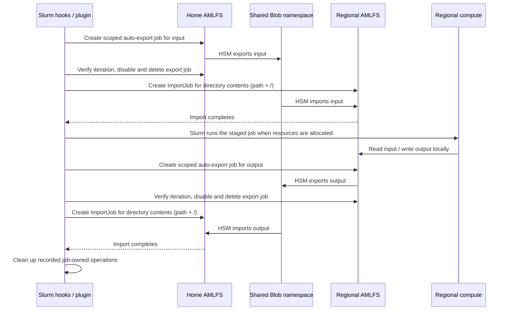

# Routing and transfer coordination

The plugin couples Slurm's staging callbacks to a recorded data route and
ordered AMLFS operations. Azure CycleCloud manages regional compute capacity,
while Slurm controls when a staged job can execute.

## Resolve the job's data route

`PARTITION_REGIONS` maps each permitted Slurm partition to an entry in
`REGIONS`. `HOME_REGION` identifies the home file system.

Each region specifies `resource_group`, `filesystem`, `location`, and
`mountpoint`. Its optional `subscription_id` overrides `SUBSCRIPTION_ID`.
Several partitions can share a regional AMLFS.

The Lua hook obtains a single resolved partition from `scontrol show job` and
passes it explicitly to the Python helper as `--partition`. A successful
lookup and a matching configuration entry are required for staging. The
runtime validates the requested source paths and records the job's route.
Jobs whose home and target identify the same AMLFS use local storage directly.

Keep the recorded route stable throughout the job lifecycle. Complete teardown
before reusing a job identifier with a different route.

## Follow the transfer lifecycle

Each export creates a fresh, job-owned `autoExportJobs` resource scoped to the
requested directory. The runtime verifies a completed export iteration with
zero failed files, disables the export, waits for `Disabled`, and deletes the
resource. It then starts the destination ImportJob and waits for the data
status `Completed`.

The import uses a slash-terminated prefix to exclude similarly named sibling
paths. Cross-region regular files are rejected; same-resource local files
remain a no-op. The selected root's exact directory metadata blob is not
imported. Prepare destination roots with the required permissions, as described
in [Directory contents and metadata](data-paths.md#directory-contents-and-metadata).

These data-status checks establish transfer completion separately from ARM
resource provisioning. Multiple paths are processed sequentially within a
stage.

## Serialize access to shared file systems

The Python runtime holds locks on **both source and destination Azure file
system identities for the entire archive/import stage**. It acquires those
locks in a consistent identity order, including for opposite-direction
transfers. Per-job locks protect route records and cleanup.

Transfers touching either file system wait for its lock. This coordinates
export and import operations with AMLFS's requirement to finish active
auto-export before importing. Transfers between disjoint pairs can overlap.
Workload owners also coordinate shared Blob paths as described in
[Namespace ownership](data-paths.md#namespace-ownership-and-refresh-policy).

All participating scheduler processes use the same `STATE_DIR` on storage
with working `flock` semantics. Keep lock files persistent while processes
use that state directory.

## Cleanup and interrupted operations

Teardown uses the exact Azure resource identities recorded for the job. It
disables and deletes its recorded auto-export jobs and deletes its recorded
ImportJobs. Operations owned by other jobs and administrators retain their
own lifecycle. A bounded deletion wait is not proof of completion: the helper
requires the delete poller to finish successfully, or an explicit ImportJob GET
to confirm resource absence after a 404. A 404 from an operation-status endpoint
alone is not treated as a missing ImportJob. Unfinished deletion and polling
errors retain ownership records, tokens, and the route for teardown retry.
Import data completion still succeeds if only its subsequent resource cleanup
fails; cleanup remains recorded rather than being silently forgotten.

The helper retries selected transient management API errors and polls
operations to their configured timeout. After an interrupted stage, inspect
the Azure operation state and the recorded ownership before retrying.
Persisted continuation tokens are diagnostic state; recovery proceeds through
the explicit inspection and cleanup process.

See [Run and monitor jobs](usage.md) for commands and
[Troubleshooting](troubleshooting.md) for recovery procedures.
